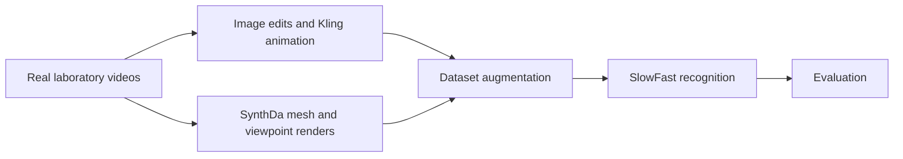
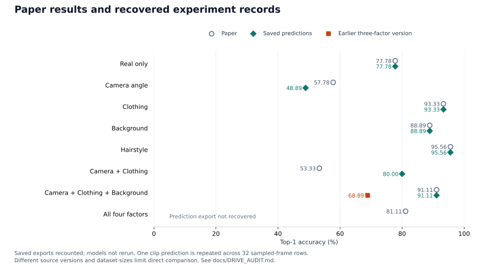

# Enhancing Classroom Monitoring in Science Experiments Using Synthetic Videos

Can synthetic training videos help recognize **shaking, swirling, and buretting** in science laboratories? This project explores video-generation techniques, creates controlled appearance and viewpoint variations, and evaluates their effect on laboratory-action recognition.

The repository combines the **original generation benchmark**, a recovered **SlowFast research notebook**, and an audit of the paper against saved experimental records. It presents a research study rather than a deployed classroom monitoring system.

[Research overview](docs/RESEARCH_OVERVIEW.md) · [Methodology](docs/METHODOLOGY.md) · [Model and code](action_recognition/README.md) · [Experiments](docs/EXPERIMENTS.md) · [Result audit](docs/DRIVE_AUDIT.md)

## Workflow



| Generation path | Controlled factors | Implementation evidence |
|---|---|---|
| [Image based](pipelines/image_based/README.md) | Background, clothing, hairstyle | Manual Google AI Studio edits and Kling animation, described in the paper and research plan; generated image/video folders inventoried |
| [Video based](pipelines/video_based/README.md) | Camera viewpoint | SynthDa integration notebooks and pose/mesh/rendering references inspected; exact lineage of the paper's selected renders remains incomplete |

The paper's design uses 90 real development videos, adds 60 synthetic videos per factor, and evaluates on 21 real videos. Recovered manifests contain an 80/20 train/validation split, and some camera-related versions use larger pools. See the [dataset audit](docs/DRIVE_AUDIT.md).

## Results and evidence

**Saved predictions were recomputed; models were not rerun.** Five paper rows have matching saved results. Two conditions differ, and the four-factor prediction export was not recovered. All paper values remain preserved in their own [source table](experiments/paper_reported_results.csv).

| Experiment | Paper Top-1 (%) | Saved predictions Top-1 (%) | Comparison |
|---|---:|---:|---|
| Real only | 77.78 | 77.78 | Matches |
| Camera angle | 57.78 | 48.89 | Different record |
| Clothing | 93.33 | 93.33 | Matches |
| Background | 88.89 | 88.89 | Matches |
| Hairstyle | 95.56 | 95.56 | Matches |
| Camera + Clothing | 53.33 | 80.00 | Different record |
| Camera + Clothing + Background | 91.11 | 91.11 / 68.89 | Two versions |
| Camera + Clothing + Background + Hairstyle | 81.11 | — | Prediction export not recovered |



The recovered evaluator assigns one clip prediction to each of its 32 sampled frames. Each saved export contains **2,880 scored rows from 90 uniform blocks**: 544 shaking, 928 swirling, and 1,408 buretting rows. These are correlated sampled-frame scores, not 2,880 independent predictions or subjects. [Evaluation details and source versions](docs/DRIVE_AUDIT.md).

Appearance augmentation is promising in the recovered records: hairstyle reaches 95.56%, clothing 93.33%, and background 88.89%, compared with the 77.78% baseline. Camera and combined-factor conclusions require care because source versions and dataset sizes differ. Filename collisions across development/test splits also require a private media/ancestry audit before claiming leakage-free evaluation.

## Repository guide

| Location | Contents |
|---|---|
| `notebooks/` | Five original generation notebooks, byte-for-byte preserved |
| `results/video.md` | Original results placeholder, unchanged |
| `action_recognition/` | Recovered research notebook, redacted saved configurations, implementation guide |
| `pipelines/` | Source-backed image/video generation workflows and limitations |
| `experiments/` | Separate paper transcription, recomputed saved-result aggregates and dataset summaries |
| `docs/` | Research design, methods, result reconciliation, reproducibility, privacy and validation |
| `scripts/`, `tests/` | Audit/plot utilities and meaningful integrity/regression checks |
| `references/` | Citation, provenance hashes, attribution and applicable license |

## Run the audits

From the repository root with Python 3.10+:

```bash
python3 scripts/audit_results.py
python3 scripts/audit_drive_results.py
python3 scripts/verify_repository.py
python3 -m unittest discover -s tests -v
```

These checks use the standard library and need no school data or GPU. To regenerate figures, install `requirements-docs.txt`, then run `scripts/plot_results.py` and `scripts/plot_drive_comparison.py`.

The [recovered training notebook](action_recognition/notebooks/slowfast_research.ipynb) is an archival implementation with known path, dependency and evaluation issues; read the [execution guide](action_recognition/README.md) before use. Restricted media, checkpoint binaries and private research documents are excluded. [Reproducibility boundaries](docs/REPRODUCIBILITY.md) · [Privacy](docs/DATA_PRIVACY.md) · [Validation](docs/VALIDATION.md).

## Preliminary synthetic technique benchmark

The original qualitative exploration is preserved as a separate stage of the project:

[CogVideoX](notebooks/CogVideoX.ipynb) · [DynamiCrafter](notebooks/DynamiCraft.ipynb) · [Text2Video](notebooks/Text2Video.ipynb) · [First Order Motion Model](notebooks/first_order_model.ipynb) · [Vid2Vid](notebooks/vid2vid.ipynb)

Read the [historical notebook audit](docs/BENCHMARK_AUDIT.md) for dependency and provenance limitations. In particular, the `Text2Video` notebook contains CLIP/CycleGAN code, although the original comparison references Text2Video-Zero. The original README is retained below in full.

## Paper and acknowledgements

Yufei Li, Edwin Chng, Megani Rajendran, Aik Beng Ng, Yong Leng Kelvin Tan, and Simon See. **Enhancing Classroom Monitoring in Science Experiments Using Synthetic Videos.** ICIET 2026, pp. 65–73. [DOI](https://doi.org/10.1109/ICIET69664.2026.11561646) · [Citation and source verification](references/README.md).

The paper acknowledges collaborators at **NVIDIA, NIE/NTU, and Hwa Chong Institution**, and support from the **NTU URECA Undergraduate Research Programme**. This project applies and integrates existing frameworks and services; it does not claim authorship of SynthDa, SlowFast/PyTorchVideo, Google AI Studio or Kling. See [contribution boundaries](docs/RESEARCH_OVERVIEW.md) and [third-party notices](references/THIRD_PARTY_NOTICES.md).

The supplied manuscript and identifiable example images are not redistributed. The supplied manuscript has not been byte-compared with the publisher's final file.

<details>
<summary>Original synthetic technique benchmark — preserved historical README</summary>

<!-- BEGIN ORIGINAL BENCHMARK README -->
# Synthetic Video Generation Benchmark

A qualitative comparison of synthetic video generation techniques, covering Text-to-Video models, Generative AI LLMs, First Order Motion Models, Diffusion Models, and Video-to-Video translation methods.

---

## Overview

This repository documents hands-on experiments with various synthetic video generation tools and models. Some models were tested online like Kling, Ying, Vidu, and Jimeng; other tools were explored through Colab notebooks included in this repo.

The goal is to provide a practical reference for researchers and practitioners choosing between synthetic video generation approaches.

---

## Techniques Compared

| Type | Technique | Advantages | Limitations |
|------|-----------|------------|-------------|
| Text-to-Video Models | [Text2Video-Zero](https://github.com/Picsart-AI-Research/Text2Video-Zero) | Fast, highly flexible and customized, high quality | Requires detailed and accurate text input |
| | [CogVideo](https://github.com/THUDM/CogVideo) | Fast, highly flexible and customized, high quality | Requires detailed and accurate text input |
| Gen AI LLMs | [Kuaishou's Kling](https://kling.kuaishou.com) | High quality, highly customizable, very mature | Can be costly |
| | [Zhipu AI's Ying](https://ying.zhipuai.cn) | High quality, highly customizable, very mature | Can be costly |
| | [Shengshu AI's Vidu](https://www.vidu.studio) | High quality, highly customizable, very mature | Can be costly |
| | [Jimeng AI](https://jimeng.jianying.com) | High quality, highly customizable, very mature | Can be costly |
| First Order Motion Models | [First Order Model](https://github.com/AliaksandrSiarohin/first-order-model) | Good for generating motion from static images, relatively simple | Limited to single-image input and simple scenes |
| Diffusion Models | [VideoCrafter](https://github.com/AILab-CVC/VideoCrafter) | High quality, fast | Computationally intensive, requires substantial data |
| | [DynamiCrafter](https://github.com/Doubiiu/DynamiCrafter) | High quality, fast | Computationally intensive, requires substantial data |
| Video-to-Video Translation | [Vid2Vid](https://github.com/NVIDIA/vid2vid) | Effective for video-to-video translation | Requires high-quality input for best results, complex setup |

---

## Repository Structure

```
synthetic-video-generation-benchmark/
├── README.md
├── notebooks/
   ├── cogvideox.ipynb
   ├── dynamicrafter.ipynb
   ├── vid2vid.ipynb
   ├── text2video.ipynb
   └── first_order_model.ipynb

```
---
## Acknowledgements

This project references and builds upon the following open-source works:

- [Text2Video-Zero](https://github.com/Picsart-AI-Research/Text2Video-Zero) by Picsart AI Research
- [CogVideo](https://github.com/THUDM/CogVideo) by THUDM
- [First Order Motion Model](https://github.com/AliaksandrSiarohin/first-order-model) by Aliaksandr Siarohin et al.
- [VideoCrafter](https://github.com/AILab-CVC/VideoCrafter) by AILab-CVC (Tencent)
- [DynamiCrafter](https://github.com/Doubiiu/DynamiCrafter) by Doubiiu et al. (ECCV 2024 Oral)
- [Vid2Vid](https://github.com/NVIDIA/vid2vid) by NVIDIA
<!-- END ORIGINAL BENCHMARK README -->

</details>
