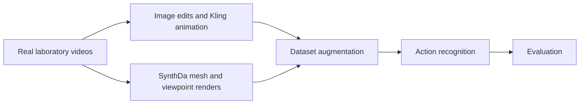

# Enhancing Classroom Monitoring in Science Experiments Using Synthetic Videos

Investigating how synthetic training videos affect recognition of **shaking, swirling, and buretting** in science laboratories. This research combines an existing video-generation technique benchmark with controlled appearance and camera-view augmentation experiments.

**Research portfolio status:** the original benchmark notebooks are preserved. The broader workflow and results below are documented from the supplied paper; the original action-recognition code, dataset manifests, and prediction logs have not yet been recovered. This repository is a research record, not a deployed classroom monitoring application.

[Research overview](docs/RESEARCH_OVERVIEW.md) · [Methodology](docs/METHODOLOGY.md) · [Experiments](docs/EXPERIMENTS.md) · [Result audit](docs/RESULTS_AND_ANALYSIS.md) · [Reproducibility](docs/REPRODUCIBILITY.md)

## Research question

Can synthetic videos improve recognition of laboratory actions when real student recordings are limited, and which appearance or viewpoint variations help? The study compares a real-only baseline with four individual augmentation factors and three combinations, using a paper-described SlowFast backbone.

## Overall workflow



The diagram summarizes the **paper-described workflow**, not a collection of executable modules in this repository. Source: [P1, Sections III-C to III-E](references/README.md).

| Generation path | What changes | Process described in the paper | Evidence available here |
|---|---|---|---|
| Image based | Background, clothing, hairstyle | Extract a first frame; edit it with Google AI Studio; animate it with an action prompt in Kling AI | Method description and aggregate results; prompt/job logs unavailable |
| Video based | Camera angle | Reconstruct human meshes with SynthDa; render front, side, and top 45-degree views | Method description and aggregate results; reconstruction/rendering code unavailable |

## Experiments and reported results

**All values below are paper-reported, not independently reproduced.** The author clarified that accuracy is evaluated per **frame**, not per video. Evaluation code, sampled-frame counts, aggregation, and split separation remain unverified. The paper specifies 21 real test videos; this is a source-video count, not an established metric denominator. See the [discrepancy report](docs/DISCREPANCIES.md).

| Experiment | Real + synthetic training videos | Top-1 (%) | Change (pp) |
|---|---:|---:|---:|
| Real only | 90 + 0 | 77.78 | +0.00 |
| Camera angle | 90 + 60 | 57.78 | -20.00 |
| Clothing | 90 + 60 | 93.33 | +15.55 |
| Background | 90 + 60 | 88.89 | +11.11 |
| Hairstyle | 90 + 60 | 95.56 | +17.78 |
| Camera + Clothing | 90 + 120 | 53.33 | -24.45 |
| Camera + Clothing + Background | 90 + 180 | 91.11 | +13.33 |
| Camera + Clothing + Background + Hairstyle | 90 + 240 | 81.11 | +3.33 |

`pp` means percentage points relative to the reported 77.78% baseline. Training counts come from P1 Tables V–VI. Each single factor adds 20 synthetic videos per action; combination rows pool larger factor sets. These are not equal-budget comparisons across all rows.


### What the reported results suggest

- Appearance edits are promising in this study: hairstyle reaches 95.56% (+17.78 pp), clothing 93.33% (+15.55 pp), and background 88.89% (+11.11 pp).
- Camera augmentation reaches 57.78% (-20.00 pp). Occlusion and reconstruction artifacts are the paper's proposed explanations; causal attribution was not independently tested.
- More synthetic data does not produce a monotonic gain: the three combinations reach 53.33%, 91.11%, and 81.11% as their synthetic budgets increase.

These observations do not establish statistical significance, generalization to other schools, or a measured privacy guarantee. Repeated seeds, confidence intervals, and a leakage audit require the missing run records.

## Existing synthetic technique benchmark

The preliminary benchmark explores generation options before the downstream action-recognition study. Its notebooks, stored outputs, qualitative comparisons, references, and acknowledgements are retained. They are separate evidence from the paper's controlled experiments.

[CogVideoX](notebooks/CogVideoX.ipynb) · [DynamiCrafter](notebooks/DynamiCraft.ipynb) · [Text2Video](notebooks/Text2Video.ipynb) · [First Order Motion Model](notebooks/first_order_model.ipynb) · [Vid2Vid](notebooks/vid2vid.ipynb)

Read the [notebook audit](docs/BENCHMARK_AUDIT.md) before execution: these are historical Colab workflows with external dependencies, and the `Text2Video` notebook contains a CLIP/CycleGAN workflow whose identity differs from the Text2Video-Zero reference in the original comparison. The original comparison is preserved below as historical content.

## Repository guide

| Location | Contents |
|---|---|
| `notebooks/` | Five original notebooks, unchanged |
| `results/video.md` | Original file, unchanged; currently contains only a newline |
| `docs/` | Workflow, experiments, analysis, reproducibility, source inventory, discrepancies, privacy, and validation |
| `experiments/` | Source-attributed transcription of the paper's aggregate results |
| `assets/figures/` | Reproducible charts of those reported results |
| `scripts/` | New documentation utilities for arithmetic, figure generation, and repository checks |
| `tests/` | Tests of the new audit utilities and preservation guarantees |
| `references/` | Source register, citation, and benchmark integrity manifest |

No empty training or pipeline directories are added: those implementations need to come from the original research materials.

## Reproduce the documentation checks

From the repository root, with Python 3.10 or newer:

```bash
python3 scripts/audit_results.py
python3 scripts/verify_repository.py
python3 -m unittest discover -s tests -v
```

To regenerate the charts in an isolated environment:

```bash
python3 -m venv .venv
source .venv/bin/activate
python3 -m pip install -r requirements-docs.txt
python3 scripts/plot_results.py
```

These commands verify the documented numbers and files; they do **not** train or evaluate SlowFast. See [reproducibility status and missing inputs](docs/REPRODUCIBILITY.md), [source inventory](docs/SOURCE_INVENTORY.md), and [validation record](docs/VALIDATION.md).

## Paper and acknowledgements

Yufei Li, Edwin Chng, Megani Rajendran, Aik Beng Ng, Yong Leng Kelvin Tan, and Simon See. **Enhancing Classroom Monitoring in Science Experiments Using Synthetic Videos.** Bibliographic records identify this as an ICIET 2026 conference paper, pp. 65–73. [DOI](https://doi.org/10.1109/ICIET69664.2026.11561646) · [Citation and verification limits](references/README.md).

The supplied manuscript is the source for the methods and tables here; its equivalence to the publisher's final file has not been established. The manuscript PDF and identifiable example images are not redistributed.

The paper acknowledges collaborators at **NVIDIA, NIE/NTU, and Hwa Chong Institution**, and funding support from the **NTU URECA Undergraduate Research Programme**. The study uses existing frameworks and services, including SynthDa, Google AI Studio, Kling AI, and SlowFast. No ownership of those systems is claimed. See [contribution boundaries](docs/RESEARCH_OVERVIEW.md) and [privacy and licensing review](docs/DATA_PRIVACY.md).

<details>
<summary>Original synthetic technique benchmark — preserved historical README</summary>

<!-- BEGIN ORIGINAL BENCHMARK README -->
# Synthetic Video Generation Benchmark

A qualitative comparison of synthetic video generation techniques, covering Text-to-Video models, Generative AI LLMs, First Order Motion Models, Diffusion Models, and Video-to-Video translation methods.

---

## Overview

This repository documents hands-on experiments with various synthetic video generation tools and models. Some models were tested online like Kling, Ying, Vidu, and Jimeng; other tools were explored through Colab notebooks included in this repo.

The goal is to provide a practical reference for researchers and practitioners choosing between synthetic video generation approaches.

---

## Techniques Compared

| Type | Technique | Advantages | Limitations |
|------|-----------|------------|-------------|
| Text-to-Video Models | [Text2Video-Zero](https://github.com/Picsart-AI-Research/Text2Video-Zero) | Fast, highly flexible and customized, high quality | Requires detailed and accurate text input |
| | [CogVideo](https://github.com/THUDM/CogVideo) | Fast, highly flexible and customized, high quality | Requires detailed and accurate text input |
| Gen AI LLMs | [Kuaishou's Kling](https://kling.kuaishou.com) | High quality, highly customizable, very mature | Can be costly |
| | [Zhipu AI's Ying](https://ying.zhipuai.cn) | High quality, highly customizable, very mature | Can be costly |
| | [Shengshu AI's Vidu](https://www.vidu.studio) | High quality, highly customizable, very mature | Can be costly |
| | [Jimeng AI](https://jimeng.jianying.com) | High quality, highly customizable, very mature | Can be costly |
| First Order Motion Models | [First Order Model](https://github.com/AliaksandrSiarohin/first-order-model) | Good for generating motion from static images, relatively simple | Limited to single-image input and simple scenes |
| Diffusion Models | [VideoCrafter](https://github.com/AILab-CVC/VideoCrafter) | High quality, fast | Computationally intensive, requires substantial data |
| | [DynamiCrafter](https://github.com/Doubiiu/DynamiCrafter) | High quality, fast | Computationally intensive, requires substantial data |
| Video-to-Video Translation | [Vid2Vid](https://github.com/NVIDIA/vid2vid) | Effective for video-to-video translation | Requires high-quality input for best results, complex setup |

---

## Repository Structure

```
synthetic-video-generation-benchmark/
├── README.md
├── notebooks/
   ├── cogvideox.ipynb
   ├── dynamicrafter.ipynb
   ├── vid2vid.ipynb
   ├── text2video.ipynb
   └── first_order_model.ipynb

```
---
## Acknowledgements

This project references and builds upon the following open-source works:

- [Text2Video-Zero](https://github.com/Picsart-AI-Research/Text2Video-Zero) by Picsart AI Research
- [CogVideo](https://github.com/THUDM/CogVideo) by THUDM
- [First Order Motion Model](https://github.com/AliaksandrSiarohin/first-order-model) by Aliaksandr Siarohin et al.
- [VideoCrafter](https://github.com/AILab-CVC/VideoCrafter) by AILab-CVC (Tencent)
- [DynamiCrafter](https://github.com/Doubiiu/DynamiCrafter) by Doubiiu et al. (ECCV 2024 Oral)
- [Vid2Vid](https://github.com/NVIDIA/vid2vid) by NVIDIA
<!-- END ORIGINAL BENCHMARK README -->

</details>
