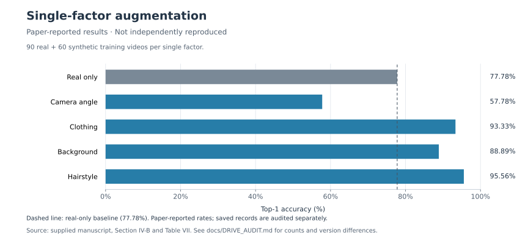
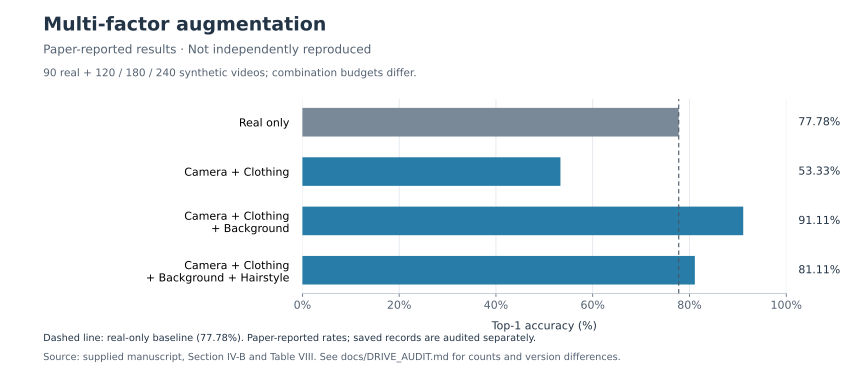

# Results and analysis

**Evidence status: paper-reported; not independently reproduced.** Values come from [P1, Section IV-B and Tables VII–VIII](../references/README.md). The author clarified frame-level accuracy; code and prediction counts have not been inspected. Figures and arithmetic are reproducible from the [transcribed CSV](../experiments/paper_reported_results.csv).

| Experiment | Real + synthetic training videos | Top-1 (%) | Change (pp) |
|---|---:|---:|---:|
| Real only | 90 + 0 | 77.78 | +0.00 |
| Camera angle | 90 + 60 | 57.78 | -20.00 |
| Clothing | 90 + 60 | 93.33 | +15.55 |
| Background | 90 + 60 | 88.89 | +11.11 |
| Hairstyle | 90 + 60 | 95.56 | +17.78 |
| Camera + Clothing | 90 + 120 | 53.33 | -24.45 |
| Camera + Clothing + Background | 90 + 180 | 91.11 | +13.33 |
| Camera + Clothing + Background + Hairstyle | 90 + 240 | 81.11 | +3.33 |

## Per-class results

| Experiment | Shaking (%) | Swirling (%) | Buretting (%) |
|---|---:|---:|---:|
| Real only | 100.00 | 86.21 | 63.64 |
| Camera angle | 76.47 | 93.10 | 27.27 |
| Clothing | 100.00 | 100.00 | 86.36 |
| Background | 100.00 | 72.41 | 95.45 |
| Hairstyle | 100.00 | 100.00 | 90.91 |
| Camera + Clothing | 100.00 | 37.93 | 45.45 |
| Camera + Clothing + Background | 100.00 | 82.76 | 93.18 |
| Camera + Clothing + Background + Hairstyle | 100.00 | 55.17 | 90.91 |

## Reading the comparisons

The reported best single factor is hairstyle. Clothing and background also exceed the real-only overall score. Background nevertheless reduces swirling from 86.21% to 72.41% (-13.80 pp), while raising buretting from 63.64% to 95.45% (+31.81 pp). An overall rate can conceal opposing class effects.

The combination sequence is non-monotonic. Combo-B exceeds Combo-A, while Combo-C falls below Combo-B. Their synthetic counts are 120, 180, and 240 overall, so these comparisons mix data volume and factor composition. The paper's “fixed budget” phrase does not describe a matched budget across these three conditions.

## Percentage points and relative changes

Absolute change: `accuracy_pct - 77.78` percentage points.

Relative change: `(accuracy_pct - 77.78) / 77.78 * 100` percent.

For hairstyle, the change is **+17.78 percentage points**, approximately **+22.86% relative** using the displayed, rounded values. For clothing, it is **+15.55 pp**, approximately **+19.99% relative**. Small rounding differences in the paper's relative percentages are retained as a caveat; no unavailable unrounded counts are substituted.

## Denominator diagnostic

The percentages are not consistent with one equally weighted classification per test video across 21 videos, nor with seven predictions per class. This is compatible with the author's frame-level clarification and does not itself demonstrate an erroneous result.

A bounded integer search gives minimum common denominators of **17 for shaking, 29 for swirling, and 44 for buretting** across the displayed class rates, under nearest rounding to two decimals. These sum to 90. With those denominators, the possible correct totals for the eight rows are 70, 52, 84, 80, 86, 48, 82, and 73; their percentages reproduce all eight Top-1 rates.

This is an **arithmetic compatibility check**, not recovered prediction data. Multiples and other rounding-compatible constructions may exist. It does not establish 90 evaluated frames, their membership, independence, sampling scheme, or which checkpoint generated them. No inferred counts are stored as observations in the source CSV. Run `python3 scripts/audit_results.py` to inspect the calculation.

## Limits of the interpretation

- No run has been independently evaluated, and no seed-to-seed variation or confidence interval is available.
- The paper's held-out-set claim is not a completed leakage audit. Generated variants of a test source would compromise separation even if filenames differ.
- Artifact/occlusion and distribution-shift explanations are plausible hypotheses discussed by P1; there is no causal ablation isolating them.
- Frame-level performance is not video-level performance. Correlated frames are not independent test subjects.
- The three actions and limited school context do not establish broader robustness, educational benefit, or privacy protection.

See [discrepancies and resolution evidence](DISCREPANCIES.md) before reusing numerical claims in a presentation or interview.
